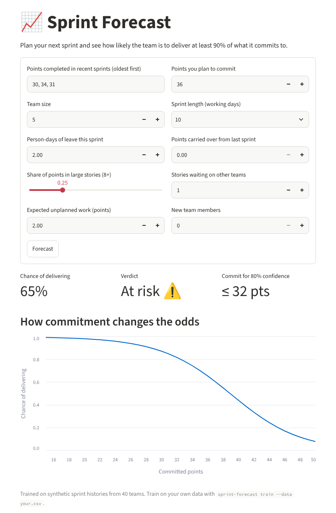
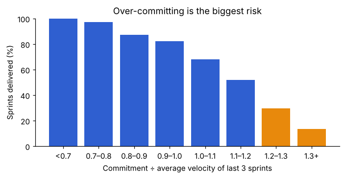
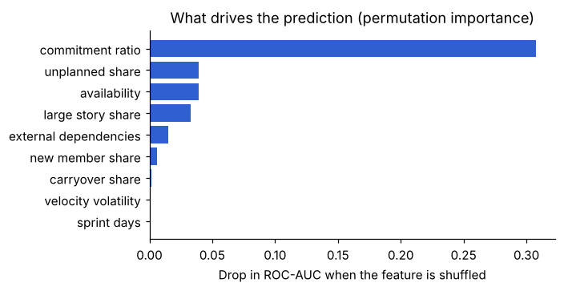
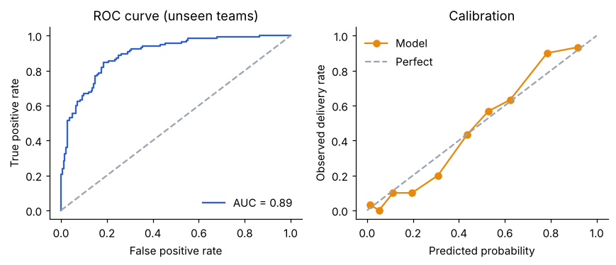

# Sprint Forecast


A machine learning model that predicts **whether a Scrum team will deliver its sprint**, and tells you **how many story points to commit to** for a given level of confidence.

> *"You're planning 36 points. There's a 59% chance you'll deliver at least 90% of it. For an 80% chance, commit to about 31."*

Sprint planning usually comes down to gut feel plus "last sprint's velocity". This project turns my postgraduate study in agile project management into a data-driven planning aid. It's the same question my [Sprint Planner API](https://github.com/volaitan/sprint-planner-api) and [project scheduler](https://github.com/volaitan/project-scheduler-cpp) work on, answered with machine learning instead.



## Results

The models are evaluated on **teams the model has never seen**. Sprints are split by team, not at random; a random split would leak each team's habits into the test set and make the scores look better than they really are.

| Model | Cross-validated ROC-AUC |
|---|---|
| logistic regression **(selected)** | 0.891 |
| random forest | 0.873 |
| gradient boosting | 0.864 |

| Test metric (unseen teams) | Value |
|---|---|
| ROC-AUC | 0.895 |
| Accuracy | 82.0% (always guessing the majority class: 61.0%) |
| F1 score | 0.769 |
| Brier score (lower is better) | 0.129 |

**The simplest model won.** Once the features were the ratios a scrum master would reason about, the relationship was nearly linear, and the tree models added variance without adding accuracy. The selected model is then **calibrated**, so a "70%" forecast really does come true about 70% of the time.

| | |
|---|---|
|  |  |



**What drives delivery:** commitment relative to recent velocity matters far more than anything else. After that come unplanned work, how many people are actually available, and the share of large stories.

## How it works

1. **Data:** `data.py` simulates 1,200 sprints across 40 teams of different sizes and speeds. Hidden rules drive the outcomes: absences reduce capacity, large stories and cross-team dependencies slip, and mid-sprint work crowds out planned work. The model never sees these rules and has to learn them. You can also load your own team's history with `load_csv()`.
2. **Features:** `features.py` turns raw numbers into ratios that work for any team size: commitment ÷ velocity, availability, velocity volatility, carry-over share, unplanned share, large-story share and new-member share.
3. **Model selection:** `model.py` compares logistic regression, random forest and gradient boosting with 5-fold **GroupKFold** cross-validation, keeps the best, calibrates it, and measures permutation importance on the held-out teams.
4. **Recommendation:** `recommend_commitment()` searches for the largest commitment that still meets the confidence you choose.

> **About the data:** real sprint histories are private, so the published results come from synthetic data. The pipeline works unchanged on a real export. See `data/sample_sprints.csv` for the format.

## Usage

```bash
git clone https://github.com/volaitan/sprint-forecast-ml.git
cd sprint-forecast-ml
python -m venv .venv && source .venv/bin/activate
pip install -e ".[app,dev]"

sprint-forecast train --charts docs                 # or: --data your_sprints.csv
sprint-forecast predict --committed 36 --history 30,34,31 --team-size 5 --leave-days 4 --dependencies 1 --unplanned 2
```

```
Chance of delivering at least 90% of 36 points: 59% (at risk)
For a 80% chance, commit to about 31 points or fewer.
```

**Interactive demo:**

```bash
streamlit run app/streamlit_app.py
```

**Tests:**

```bash
pytest -v
```

The tests check that the data generator is deterministic, that the features are correct, and that the model beats the majority-class baseline on unseen teams. They also check that predictions make common sense: committing more, or having people on leave, never raises the forecast.

## Project structure

```
src/sprint_forecast/
├── data.py        # Synthetic generator and CSV loader with validation
├── features.py    # Feature engineering
├── model.py       # Model comparison, group CV, calibration, importance, recommendation
├── report.py      # Evaluation charts and Markdown tables
└── cli.py         # generate / train / predict
app/streamlit_app.py   # Interactive what-if tool
tests/                 # pytest suite, run by GitHub Actions on Python 3.10 and 3.12
```

## Ideas for next steps

- Pull sprint history straight from the Sprint Planner API or Jira
- Predict the completion percentage itself (regression), with prediction intervals
- SHAP explanations for each individual forecast

## Licence

MIT
